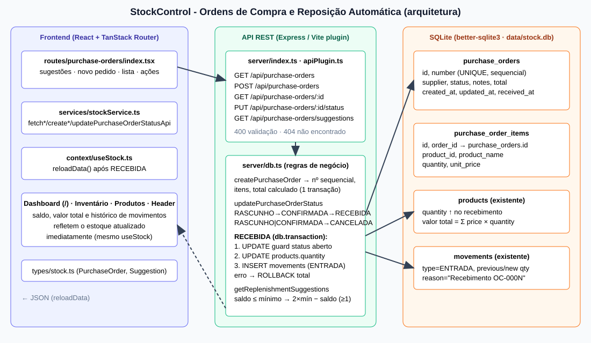

# Ordens de Compra e Reposição Automática - Arquitetura

## Componentes

| Camada | Arquivo | Responsabilidade |
|---|---|---|
| UI | `src/routes/purchase-orders/index.tsx` | Sugestões, criação de pedido, listagem, ações Confirmar/Receber/Cancelar |
| Serviço | `src/services/stockService.ts` | Chamadas REST dos pedidos e sugestões |
| Estado | `src/context/useStock.ts` | `reloadData()` após recebimento atualiza Dashboard, Produtos, Inventário e Header |
| API | `src/server/index.ts`, `src/server/apiPlugin.ts` | 5 endpoints (Express em produção, plugin Vite em dev) |
| Domínio | `src/server/db.ts` | Regras de negócio e transações SQLite |
| Tipos | `src/types/stock.ts` | `PurchaseOrder`, `PurchaseOrderItem`, `ReplenishmentSuggestion` |

## Modelo de dados (SQLite)

- `purchase_orders(id, number UNIQUE, supplier, status, notes, total, created_at, updated_at, received_at)`
- `purchase_order_items(id, order_id, product_id, product_name, quantity, unit_price)`
- Reutiliza `products` e `movements`.

## Endpoints

| Método | Rota | Resultado |
|---|---|---|
| GET | `/api/purchase-orders` | lista (mais recente primeiro) |
| POST | `/api/purchase-orders` | cria em `RASCUNHO`; 201, ou 400 se inválido |
| GET | `/api/purchase-orders/:id` | detalhe ou 404 |
| PUT | `/api/purchase-orders/:id/status` | body `{status}`; 400 transição inválida, 404 inexistente |
| GET | `/api/purchase-orders/suggestions` | produtos com saldo ≤ mínimo |

## Máquina de estados

`RASCUNHO → CONFIRMADA → RECEBIDA`; `RASCUNHO | CONFIRMADA → CANCELADA`; `RECEBIDA` e `CANCELADA` são terminais (nova tentativa de recebimento retorna 400).
`RASCUNHO → RECEBIDA` direto também é permitido.

## Recebimento (transação atômica)

Dentro de uma única `db.transaction` do better-sqlite3:
1. leitura do pedido e checagem de status;
2. `UPDATE ... WHERE status IN ('RASCUNHO','CONFIRMADA')` (guarda contra recebimento duplicado/concorrente);
3. para cada item: `UPDATE products.quantity` + `INSERT movements (ENTRADA)`;
4. qualquer erro (ex.: produto removido) reverte tudo.

O valor total do estoque é derivado (`Σ price × quantity`), logo é atualizado com o saldo.

## Sugestão de reposição

Para produtos com `stockQuantity <= minStock`: `alvo = max(2 × minStock, minStock + 1)`, `sugerido = max(alvo − saldo, 1)`. Nível `ESGOTADO` (saldo 0) ou `CRITICO`. Ordenado por urgência.

## Premissas

- Preço unitário do item padrão = preço do produto, podendo ser informado no POST.
- Não há edição de itens após a criação (somente mudança de status).
- Produtos repetidos no mesmo pedido são consolidados em uma linha.
- `reset-seed` também limpa os pedidos.
